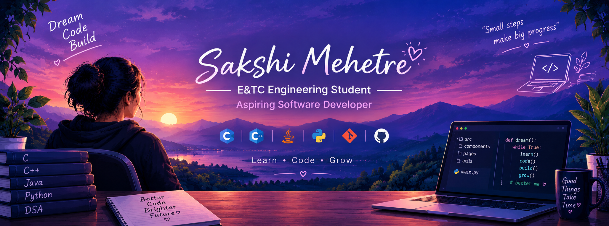

  

---

# Hi there, I'm Sakshi Mehetre! 👋

### E&TC Engineering Student | Aspiring Software Developer

Welcome to my GitHub profile! I'm an enthusiastic engineering student interested in software development, programming, and exploring new technologies.

---

## 👩‍💻 About Me

- 🎓 Electronics & Telecommunication (E&TC) Engineering Student.
- 💻 Interested in Software Development.
- 🌱 Continuously learning and improving my programming skills.
- 🚀 Exploring new technologies and building practical projects.
- 🎯 Aspiring to become a skilled software developer.

---

## 🛠️ Technical Skills

**Programming Languages**

  
  
  
  

---

## 📚 Currently Learning

- Programming Fundamentals
- Data Structures and Algorithms
- Object-Oriented Programming
- Software Development Concepts
- Problem Solving

---

---

## 📊 GitHub Statistics

  
  

## 🔥 GitHub Streak

  

---

---

## 🌱 My Learning Journey

Currently focusing on:

- Learning C and C++ programming.
- Exploring Java and Python.
- Strengthening Data Structures and Algorithms.
- Improving logical thinking and problem-solving skills.
- Understanding software development concepts.

## 🎯 My Goals

- Build real-world programming projects.
- Improve coding and problem-solving skills.
- Learn new technologies.
- Contribute to open-source projects.
- Grow as a software developer.

---

## 🌐 Connect With Me

  

  

---

---

## 👀 Profile Visitors

  

### 💫 Thanks for visiting my profile!

*Learning • Building • Growing*
